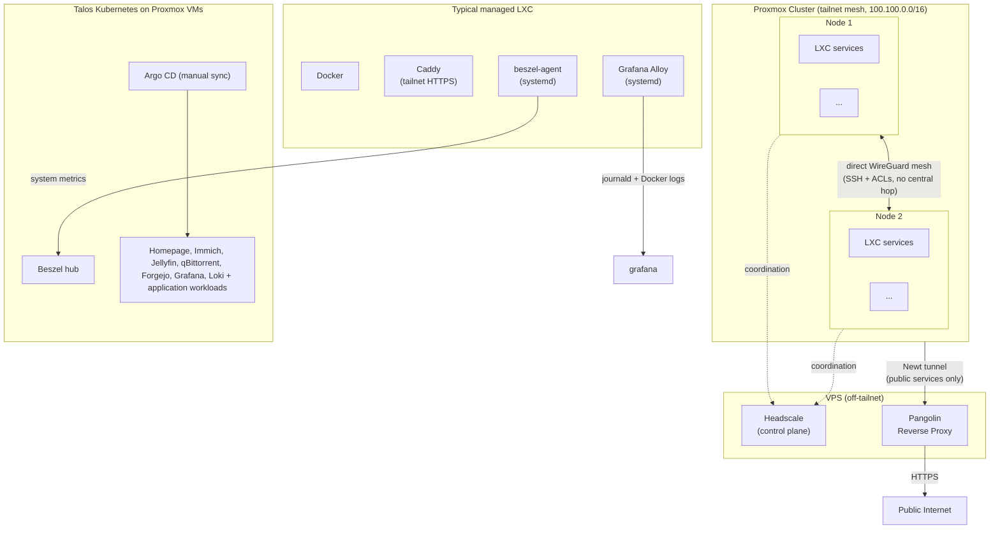

# homelab

This repo contains [Ansible playbooks](./ansible/playbooks/) and Docker Compose files that provision and manage a fully self-hosted homelab running on [Proxmox](https://proxmox.com).

Services run on either Ubuntu LXC containers managed by Ansible or on a three-node Talos Kubernetes cluster managed through Argo CD. [Headscale](https://headscale.net) (self-hosted Tailscale control plane) handles networking, and [Grafana Alloy](https://grafana.com/docs/alloy/) ships logs to Loki.

---

## Documentation

| Area | Start here |
|---|---|
| Kubernetes applications and platform | [Kubernetes overview](kubernetes/README.md) |
| Talos VMs and recovery constraints | [Cluster layout](kubernetes/cluster/README.md) |
| Application updates and ownership | [Release management](kubernetes/apps/argocd/MANAGEMENT.md) |
| Kubernetes backups and restore drill | [Backup runbook](kubernetes/BACKUPS.md) |
| VPS backup automation | [Backup role](ansible/roles/vps_backup/README.md) |

## Architecture



Most Ansible-managed LXC containers run:

- **Docker** (installed via Ansible)
- **Grafana Alloy** (systemd service — ships journald + Docker logs → central Loki)
- **beszel-agent** (systemd service — reports system metrics → central Beszel)

Hosts without Docker collect journal logs only. The off-tailnet VPS
skips Alloy and Beszel. Kubernetes uses an Alloy DaemonSet for pod logs.

---

## Services

### 🤖 AI & Smart Search

| Service | Description |
|---|---|
| [Immich](https://immich.app) | Self-hosted Google Photos replacement with ML-powered face recognition, CLIP semantic search, and smart albums |
| [Paperless-ngx](https://docs.paperless-ngx.com) | AI-assisted document management with automatic tagging, classification, and OCR |
| [SearXNG](https://searxng.github.io/searxng/) | Privacy-respecting meta search engine; also used as a retrieval backend for LLM agents |

### 📸 Media & Entertainment

| Service | Description |
|---|---|
| [Jellyfin](https://jellyfin.org) | Open-source media server for movies, TV, and music |
| [Navidrome](https://navidrome.org) | Subsonic-compatible music streaming server |
| [Audiobookshelf](https://www.audiobookshelf.org) | Self-hosted audiobook and podcast server |
| [Invidious](https://invidious.io) | Privacy-respecting YouTube frontend |
| [RomM](https://github.com/rommapp/romm) | ROM manager and game library for retro games |
| [Minecraft Bedrock](https://www.minecraft.net) | Bedrock edition game server |
| [Sonarr](https://sonarr.tv) | TV series management and automation |
| [Radarr](https://radarr.video) | Movie management and automation |
| [Lidarr](https://lidarr.audio) | Music management and automation |
| [Prowlarr](https://github.com/Prowlarr/Prowlarr) | Indexer manager for the \*arr ecosystem |
| [qBittorrent](https://qbittorrent.org) | BitTorrent client |
| [Seerr](https://github.com/seerr-team/seerr) | Media request management (Overseerr fork) |
| [FlareSolverr](https://github.com/FlareSolverr/FlareSolverr) | Cloudflare bypass proxy for indexers |

### 🗂️ Productivity & Knowledge

| Service | Description |
|---|---|
| [Miniflux](https://miniflux.app) | Minimalist RSS reader |
| [Kiwix](https://kiwix.org) | Offline access to Wikipedia, Stack Overflow, and more |
| [Maloja](https://github.com/krateng/maloja) | Self-hosted scrobbling server (Last.fm alternative) |
| [LubeLogger](https://lubelogger.com) | Vehicle maintenance tracker |
| [Bento PDF](https://github.com/alam00000/bentopdf) | PDF manipulation tool |

### 🏠 Home Dashboard

| Service | Description |
|---|---|
| [Homepage](https://gethomepage.dev) | Highly customizable services dashboard with live widget integrations |

### 🔔 Notifications

| Service | Description |
|---|---|
| [Gotify](https://gotify.net) | Self-hosted push notification server |
| [Apprise](https://github.com/caronc/apprise) | Multi-platform notification gateway |
| [iGotify](https://github.com/androidseb25/igotify-notification-assist) | iOS push notification bridge for Gotify |

### 🌐 Networking & Security

| Service | Description |
|---|---|
| [AdGuard Home](https://adguard.com/adguard-home.html) | Network-wide DNS ad and tracker blocking |
| [upSnap](https://github.com/seriousm4x/upSnap) | Wake-on-LAN dashboard for waking devices on the LAN |
| [Pangolin](https://github.com/fosrl/pangolin) | Reverse proxy with WireGuard tunneling for public-facing services (runs on a VPS, managed by `playbooks/vps`) |

### 🔧 Developer Tools

| Service | Description |
|---|---|
| [Forgejo](https://forgejo.org) | Self-hosted Git service (Gitea fork) |
| [Umami](https://umami.is) | Privacy-focused website analytics |

### 📊 Observability Stack

| Service | Description |
|---|---|
| [Grafana](https://grafana.com) | Metrics and log dashboards |
| [Loki](https://grafana.com/oss/loki/) | Log aggregation backend, receives from all Alloy agents |
| [Gatus](https://gatus.io) | Automated service health monitoring with alerting |
| [Beszel](https://github.com/henrygd/beszel) | Lightweight server monitoring hub |
| [Speedtest Tracker](https://github.com/linuxserver/docker-speedtest-tracker) | Scheduled internet speed history |
| [WatchYourLAN](https://github.com/aceberg/watchyourlan) | Network IP scanner and device tracker |
| [ChangeDetection.io](https://changedetection.io) | Website change monitoring and alerting |

---

## Networking

Tailnet hosts run the **Tailscale client** against Headscale with [Tailscale SSH](https://tailscale.com/kb/1193/tailscale-ssh) enabled. The off-tailnet VPS uses ordinary SSH through the operator’s SSH configuration. The Headscale ACL source is `ansible/playbooks/vps/policy.headscale.hujson`. The VPS playbook validates it and updates Headscale's policy database when the active policy differs. The VPS is excluded from CI, so run `just run main --limit vps` from the repo root to apply policy changes. The Headscale server itself runs in Docker on the VPS, which stays off the tailnet.

The ACL and `headscale_node_tags` configuration define tagged-service access.
Use `just check-headscale-policy` to compare the live policy and managed tags;
do not infer effective permissions from a host's name or previous enrollment.

For public-facing services, a **[Pangolin](https://github.com/fosrl/pangolin)** reverse proxy runs on the same VPS. Each service that needs public exposure runs a **Newt** sidecar container that tunnels directly from the Proxmox cluster to Pangolin, no inbound firewall rules required.

For tailnet-only services on Kubernetes, the central Cilium Gateway is now the front door (see [Cluster layout](kubernetes/cluster/README.md)). Per-node **[Caddy](https://caddyserver.com)** instances remain for tailnet-only LXC services, providing HTTPS with automatic Let's Encrypt certificates (DNS-01 via Cloudflare), replacing Tailscale Serve. Their Docker UI ports bind to localhost so other tailnet nodes reach the UI through Caddy. Other ports needed by services, such as Loki ingestion and qBittorrent peer traffic, remain separately exposed.

Headscale advertises the primary AdGuard Home resolver and a secondary AdGuard Home instance on the Gatus host. Deploy the Gatus playbook before manually running the VPS playbook so the second resolver is available when Headscale advertises it. Keep the filters and DNS rewrites in `ansible/playbooks/gatus/adguard-secondary.yaml.j2` aligned with the primary AdGuard instance.

---

## Logging

Managed tailnet LXC hosts run **[Grafana Alloy](https://grafana.com/docs/alloy/)** as a systemd service. It ships two log streams to a central Loki instance:

- **journald** — all systemd unit logs, labelled with `host` and `unit`
- **Docker** — all container logs, labelled with `host` and `container` name

The Kubernetes Alloy DaemonSet collects pod logs through the Kubernetes API;
it does not collect Talos node service logs. See the [logging runbook](kubernetes/OBSERVABILITY.md).

---

## Setup

### Prerequisites

- A Proxmox cluster with LXC containers provisioned and named to match `ansible/inventory`
- Tailscale client registered with Headscale on tailnet containers; SSH access configured separately for the VPS
- Ansible Vault password written to `ansible/.vault_pass`

### Developer Environment

A [Nix flake](./flake.nix) provides a reproducible dev shell with all required tools:

```sh
nix develop   # Ansible, ansible-lint, just, shellcheck, yamllint
```

Or install those tools manually.

### Running Playbooks

Deployment recipes run from the repo root and apply changes to live hosts.
The all-host list is defined in [playbooks/main.yml](ansible/playbooks/main.yml);
it excludes retired LXC workloads. Kubernetes follows the separate
[Argo CD workflow](kubernetes/apps/argocd/MANAGEMENT.md).

```sh
# Install required Ansible Galaxy collections
just setup

# Run all playbooks
just run

# Provision Kubernetes external Secrets and Homepage config maps
just run talos-cluster/gitops-secrets
```

## Maintenance

[Renovate](https://docs.renovatebot.com) monitors all Docker image versions and opens PRs with updates. Review version pins and, for Kubernetes images, SHA digests in configuration. Custom versioning rules handle date-versioned images like SearXNG and Invidious.

---
