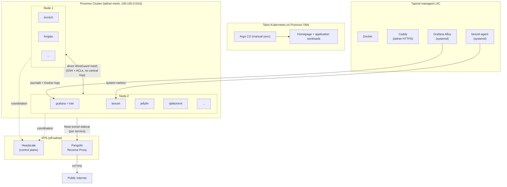

# homelab

This repo contains [Ansible playbooks](./ansible/playbooks/) and Docker Compose files that provision and manage a fully self-hosted homelab running on [Proxmox](https://proxmox.com).

Services run on either Ubuntu LXC containers managed by Ansible or on a three-node Talos Kubernetes cluster managed through Argo CD. [Headscale](https://headscale.net) (self-hosted Tailscale control plane) handles networking, and [Grafana Alloy](https://grafana.com/docs/alloy/) ships logs to Loki.

---

## Documentation

| Area | Start here |
|---|---|
| Kubernetes applications and platform | [Kubernetes overview](kubernetes/README.md) |
| Talos VMs and recovery constraints | [Cluster layout](kubernetes/cluster/README.md) |
| Application updates and ownership | [Release management](kubernetes/apps/argocd/MANAGEMENT.md) |
| Kubernetes backups and restore drill | [Backup runbook](kubernetes/BACKUPS.md) |
| VPS backup automation | [Backup role](ansible/roles/vps_backup/README.md) |

## Architecture



Most Ansible-managed LXC containers run:

- **Docker** (installed via Ansible)
- **Grafana Alloy** (systemd service — ships journald + Docker logs → central Loki)
- **beszel-agent** (systemd service — reports system metrics → central Beszel)

Hosts without Docker collect journal logs only. The off-tailnet Pangolin VPS
skips Alloy and Beszel. Kubernetes uses an Alloy DaemonSet for pod logs.

---

## Services

### 🤖 AI & Smart Search

| Service | Description |
|---|---|
| [Immich](https://immich.app) | Self-hosted Google Photos replacement with ML-powered face recognition, CLIP semantic search, and smart albums |
| [Paperless-ngx](https://docs.paperless-ngx.com) | AI-assisted document management with automatic tagging, classification, and OCR |
| [SearXNG](https://searxng.github.io/searxng/) | Privacy-respecting meta search engine; also used as a retrieval backend for LLM agents |

### 📸 Media & Entertainment

| Service | Description |
|---|---|
| [Jellyfin](https://jellyfin.org) | Open-source media server for movies, TV, and music |
| [Navidrome](https://navidrome.org) | Subsonic-compatible music streaming server |
| [Audiobookshelf](https://www.audiobookshelf.org) | Self-hosted audiobook and podcast server |
| [Dispatcharr](https://github.com/Dispatcharr/Dispatcharr) | IPTV playlist and EPG manager |
| [Invidious](https://invidious.io) | Privacy-respecting YouTube frontend |
| [RomM](https://github.com/rommapp/romm) | ROM manager and game library for retro games |
| [Minecraft Bedrock](https://www.minecraft.net) | Bedrock edition game server |
| [Sonarr](https://sonarr.tv) | TV series management and automation |
| [Radarr](https://radarr.video) | Movie management and automation |
| [Lidarr](https://lidarr.audio) | Music management and automation |
| [Prowlarr](https://github.com/Prowlarr/Prowlarr) | Indexer manager for the \*arr ecosystem |
| [qBittorrent](https://qbittorrent.org) | BitTorrent client |
| [Seerr](https://github.com/seerr-team/seerr) | Media request management (Overseerr fork) |
| [FlareSolverr](https://github.com/FlareSolverr/FlareSolverr) | Cloudflare bypass proxy for indexers |

### 🗂️ Productivity & Knowledge

| Service | Description |
|---|---|
| [Miniflux](https://miniflux.app) | Minimalist RSS reader |
| [Kiwix](https://kiwix.org) | Offline access to Wikipedia, Stack Overflow, and more |
| [Maloja](https://github.com/krateng/maloja) | Self-hosted scrobbling server (Last.fm alternative) |
| [LubeLogger](https://lubelogger.com) | Vehicle maintenance tracker |
| [Bento PDF](https://github.com/alam00000/bentopdf) | PDF manipulation tool |

### 🏠 Home Dashboard

| Service | Description |
|---|---|
| [Homepage](https://gethomepage.dev) | Highly customizable services dashboard with live widget integrations |

### 🔔 Notifications

| Service | Description |
|---|---|
| [Gotify](https://gotify.net) | Self-hosted push notification server |
| [Apprise](https://github.com/caronc/apprise) | Multi-platform notification gateway |
| [iGotify](https://github.com/androidseb25/igotify-notification-assist) | iOS push notification bridge for Gotify |

### 🌐 Networking & Security

| Service | Description |
|---|---|
| [AdGuard Home](https://adguard.com/adguard-home.html) | Network-wide DNS ad and tracker blocking |
| [upSnap](https://github.com/seriousm4x/upSnap) | Wake-on-LAN dashboard for waking devices on the LAN |
| [Pangolin](https://github.com/fosrl/pangolin) | Reverse proxy with WireGuard tunneling for public-facing services (runs on a VPS, managed by `playbooks/pangolin`) |

### 🔧 Developer Tools

| Service | Description |
|---|---|
| [Forgejo](https://forgejo.org) | Self-hosted Git service (Gitea fork) |
| [Umami](https://umami.is) | Privacy-focused website analytics |

### 📊 Observability Stack

| Service | Description |
|---|---|
| [Grafana](https://grafana.com) | Metrics and log dashboards |
| [Loki](https://grafana.com/oss/loki/) | Log aggregation backend, receives from all Alloy agents |
| [Gatus](https://gatus.io) | Automated service health monitoring with alerting |
| [Beszel](https://github.com/henrygd/beszel) | Lightweight server monitoring hub |
| [Speedtest Tracker](https://github.com/linuxserver/docker-speedtest-tracker) | Scheduled internet speed history |
| [WatchYourLAN](https://github.com/aceberg/watchyourlan) | Network IP scanner and device tracker |
| [ChangeDetection.io](https://changedetection.io) | Website change monitoring and alerting |

---

## Networking

Tailnet hosts run the **Tailscale client** against Headscale with [Tailscale SSH](https://tailscale.com/kb/1193/tailscale-ssh) enabled. The off-tailnet Pangolin VPS uses ordinary SSH through the operator’s SSH configuration. The Headscale ACL source is `ansible/playbooks/pangolin/policy.headscale.hujson`. The Pangolin playbook validates it and updates Headscale's policy database when the active policy differs. Pangolin is excluded from CI, so run `just run "--limit pangolin"` from `ansible/` to apply policy changes. The Headscale server itself runs in Docker on the Pangolin VPS, which stays off the tailnet.

The remote nodes `muse` and `mcleod` use `tag:external` and can initiate tailnet DNS queries. `mcleod` also uses `tag:beszel-agent`, which allows it to send metrics to the Beszel HTTPS endpoint without granting access to Loki or other tagged services. Pangolin Newt hosts use `tag:pangolin` plus `tag:monitored`; they can reach the Beszel HTTPS endpoint and Loki ingestion port, with Navidrome separately allowed to reach Maloja over HTTPS. The Beszel, Loki, and Maloja hosts have dedicated destination tags. These tagged nodes cannot initiate SSH; tailnet member devices can SSH into tagged nodes when the destination accepts Tailscale SSH. The Pangolin playbook assigns tags by hostname from `headscale_node_tags` after nodes enroll, so re-registered nodes regain their tags on the next playbook run. Check the live policy and all managed tags with `just check-headscale-policy`.

For public-facing services, a **[Pangolin](https://github.com/fosrl/pangolin)** reverse proxy runs on the same VPS. Each service that needs public exposure runs a **Newt** sidecar container that tunnels directly from the Proxmox cluster to Pangolin, no inbound firewall rules required.

For tailnet-only services, a per-node **[Caddy](https://caddyserver.com)** instance provides HTTPS with automatic Let's Encrypt certificates (DNS-01 via Cloudflare), replacing Tailscale Serve. Their Docker UI ports bind to localhost so other tailnet nodes reach the UI through Caddy. Other ports needed by services, such as Loki ingestion and qBittorrent peer traffic, remain separately exposed.

Headscale advertises the primary AdGuard Home resolver and a secondary AdGuard Home instance on the Gatus host. Deploy the Gatus playbook before manually running the Pangolin playbook so the second resolver is available when Headscale advertises it. Keep the filters and DNS rewrites in `ansible/playbooks/gatus/adguard-secondary.yaml.j2` aligned with the primary AdGuard instance.

---

## Logging

Managed tailnet LXC hosts run **[Grafana Alloy](https://grafana.com/docs/alloy/)** as a systemd service. It ships two log streams to a central Loki instance:

- **journald** — all systemd unit logs, labelled with `host` and `unit`
- **Docker** — all container logs, labelled with `host` and `container` name

The Kubernetes Alloy DaemonSet collects pod logs through the Kubernetes API;
it does not collect Talos node service logs. See the [logging runbook](kubernetes/OBSERVABILITY.md).

---

## Setup

### Prerequisites

- A Proxmox cluster with LXC containers provisioned and named to match `ansible/inventory`
- Tailscale client registered with Headscale on tailnet containers; SSH access configured separately for Pangolin
- Ansible Vault password written to `ansible/.vault_pass`

### Developer Environment

A [Nix flake](./flake.nix) provides a reproducible dev shell with all required tools:

```sh
nix develop   # Ansible, ansible-lint, just, shellcheck, yamllint
```

Or install those tools manually.

### Running Playbooks

LXC deployment commands run from `ansible/` and apply changes to live hosts.
The all-host list is defined in [playbooks/main.yml](ansible/playbooks/main.yml);
it excludes retired LXC workloads. Kubernetes follows the separate
[Argo CD workflow](kubernetes/apps/argocd/MANAGEMENT.md).

```sh
# Install required Ansible Galaxy collections
just setup

# Run all playbooks
just run ""

# Run a single service
just run "--limit immich"

# Run one playbook directly
ansible-playbook playbooks/immich/main.yml -i inventory --vault-password-file .vault_pass
```

## Maintenance

Work on local `main`; push only when explicitly requested. A push touching
`ansible/**` triggers the Forgejo deployment matrix, and the daily schedule
reapplies eligible playbooks. The matrix discovers service `main.yml` files
independently of the all-host import list and skips `.no-ci` directories.
Manual single-host dispatch also refuses `.no-ci` hosts. The local
`just run-parallel` recipe does **not** honor those markers; inspect it before use.

From the repository root, run `just lint` for YAML, Ansible, and shell checks.
Talos syntax checks load Vault variables; set `ANSIBLE_VAULT_PASSWORD_FILE`
to the protected local password helper when needed. `just install-hooks`
configures the repository's pre-commit checks.

[Renovate](https://docs.renovatebot.com) monitors all Docker image versions and opens PRs with updates. All images are pinned to specific versions **and** SHA digests (e.g., `image:v1.2.3@sha256:abc123`) to prevent silent supply-chain drift. Custom versioning rules handle date-versioned images like SearXNG and Invidious.

[ProxMenux](https://github.com/MacRimi/ProxMenux) is used to run update scripts and monitor key vitals of running Proxmox nodes.

---

## Compose image index

Generated from tracked Compose files and Kubernetes YAML by
[generate-containers-table.sh](generate-containers-table.sh). Kubernetes image
versions are read from image references and `repository`/`tag` values.

<!-- DOCKER_SERVICES_START -->
| Image | Version |
|-------|---------|
| docker.io/aceberg/watchyourlan | v2 |
| docker.io/adguard/adguardhome | v0.107.79 |
| docker.io/caronc/apprise | 2.0.1 |
| docker.io/deluan/navidrome | 0.64.2 |
| docker.io/dgtlmoon/changedetection.io | 0.60.9 |
| docker.io/fosrl/gerbil | 1.5.2 |
| docker.io/fosrl/newt | 1.19.0 |
| docker.io/fosrl/pangolin | 1.25.3 |
| docker.io/gotify/server | 3.1.1 |
| docker.io/grafana/grafana | 13.2.4 |
| docker.io/grafana/loki | 3.7.9 |
| docker.io/headscale/headscale | v0.29.5 |
| docker.io/henrygd/beszel | 0.21.1 |
| docker.io/itzg/minecraft-bedrock-server | 2026.10.1 |
| docker.io/jellyfin/jellyfin | 12.3 |
| docker.io/krateng/maloja | 3.2.9 |
| docker.io/library/busybox | 1.37 |
| docker.io/library/postgres | 18.6 |
| docker.io/library/redis | 8 |
| docker.io/library/redis | 8.10.2-alpine |
| docker.io/linuxserver/lidarr | 3.1.0 |
| docker.io/linuxserver/prowlarr | 2.6.5 |
| docker.io/linuxserver/qbittorrent | 5.3.0 |
| docker.io/linuxserver/radarr | 6.4.4 |
| docker.io/linuxserver/sonarr | 4.0.20 |
| docker.io/linuxserver/speedtest-tracker | 1.15.1 |
| docker.io/mariadb | 13.0.2 |
| docker.io/miniflux/miniflux | 2.3.4 |
| docker.io/paperlessngx/paperless-ngx | 3.3.3 |
| docker.io/postgres | 18.6 |
| docker.io/rancher/local-path-provisioner | v0.0.31 |
| docker.io/rommapp/romm | 5.4.0 |
| docker.io/searxng/searxng | 2026.10.23-68647d080 |
| docker.io/traefik | v3.7 |
| docker.io/twinproduction/gatus | v5.37.0 |
| docker.io/valkey/valkey | 9 |
| docker.io/velero/velero | v1.18.2 |
| docker.io/velero/velero-plugin-for-aws | v1.14.4 |
| docker.io/victoriametrics/victoria-metrics | v1.154.1 |
| forgejo/forgejo | 17.0.0 |
| ghcr.io/advplyr/audiobookshelf | 2.37.1 |
| ghcr.io/alam00000/bentopdf | 2.8.10 |
| ghcr.io/androidseb25/igotify-notification-assist | v1.6.0.1 |
| ghcr.io/davegallant/homelab-caddy-cloudflare | 2.11.6-a8737d0 |
| ghcr.io/dispatcharr/dispatcharr | 0.32.0 |
| ghcr.io/flaresolverr/flaresolverr | v3.5.2 |
| ghcr.io/gethomepage/homepage | v2.7.0 |
| ghcr.io/hargata/lubelogger | v1.4.5 |
| ghcr.io/immich-app/immich-machine-learning | v3.3.5 |
| ghcr.io/immich-app/immich-server | v3.3.5 |
| ghcr.io/immich-app/postgres | 14-vectorchord0.4.3-pgvectors0.2.0 |
| ghcr.io/kiwix/kiwix-serve | 3.8.2 |
| ghcr.io/seerr-team/seerr | v3.5.1 |
| ghcr.io/seriousm4x/upsnap | 5.7.2 |
| ghcr.io/tailscale/tailscale | v1.104.1 |
| ghcr.io/tailscale/tailscale | v1.104.2 |
| ghcr.io/umami-software/umami | 3.4.0 |
| quay.io/invidious/invidious | 2026.10.23-4a271da |
| quay.io/invidious/invidious-companion | 2026.10.18-fcb0456 |
| registry.k8s.io/kubectl | v1.37.0 |
<!-- DOCKER_SERVICES_END -->
